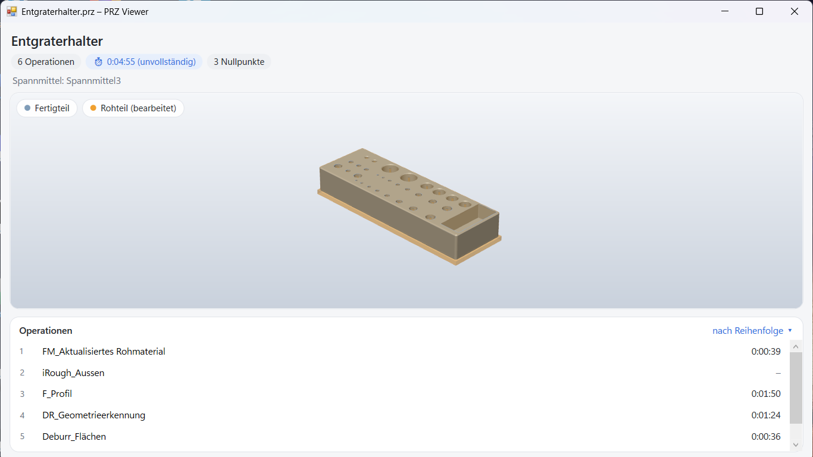

# PRZ Vorschau

Vorschau für `.prz`-Dateien aus SolidCAM direkt im Vorschaufenster des Windows-Explorers – ohne das CAM-System zu öffnen.

> **⬇ Download:** [Neueste Version herunterladen](https://github.com/woityschreck/prz-preview/releases/latest) – dort unter **Assets** die Datei **`PRZ-Vorschau-x.y.z.zip`** nehmen (nicht „Source code“).

## Funktionen

- 3D-Modell des Fertigteils (drehen, verschieben, zoomen) und das bearbeitete Rohteil
- Operationen in Bearbeitungsreihenfolge mit Bearbeitungszeiten, Gesamtzeit, Sortierung nach Dauer
- Spannmittel-Name und Anzahl der Nullpunkte
- Eigenständiger Viewer (`PrzViewer.exe`) mit Drag & Drop
- Liest Dateien nur, verändert nichts, keine Netzwerkverbindung

## Installation

**Klassisch (benötigt einmal Adminrechte):** [Release-ZIP](https://github.com/woityschreck/prz-preview/releases/latest) herunterladen, entpacken, `Installieren.cmd` ausführen.
Danach Explorer neu öffnen, eine `.prz` markieren, Vorschaufenster mit `Alt+P` einschalten.

**MSIX / Microsoft Store (ohne Adminrechte):** in Vorbereitung.

Voraussetzungen: Windows 10 (1809+) oder Windows 11, x64. .NET Framework 4.8 ist in Windows enthalten; das CAM-System muss nicht installiert sein.

## Aufbau

| Pfad | Inhalt |
|---|---|
| `src/PrzData.cs` | Liest die `.prz` (ZIP): Operationsliste, Zeiten, Nullpunkte, Spannmittel, STL-/STF-Modelle |
| `src/ModelViewer.cs` | 3D-Ansicht (WPF) |
| `src/PrzPreviewControl.cs` | Oberfläche der Vorschau |
| `src/PreviewHandler.cs` | Explorer-Vorschau-Handler (COM, `IPreviewHandler`) |
| `src/shim/PrzShim.cpp` | Native COM-Brücke für das MSIX-Paket (startet .NET 4.8 im Vorschau-Prozess) |
| `src/Viewer.cs` | Eigenständiger Viewer |
| `setup/` | Klassischer Installer (Registrierung unter HKLM) |
| `msix/` | MSIX-Manifest und Paket-Identität |
| `store/` | Datenschutzerklärung, Symbole, Screenshots für den Store |
| `tools/` | Nur für Entwickler: selbst gebaute DLL registrieren/entfernen |

## Bauen

- **Klassisch:** `build.cmd` – nutzt den C#-Compiler aus .NET Framework 4 (in Windows enthalten), Ausgabe in `bin/`.
- **MSIX:** `build-msix.ps1` – benötigt zusätzlich die VS 2017 Build Tools (C++) und das Windows SDK 10.0.19041.
  `-Register` installiert das Paket lokal zum Testen (Windows-Entwicklermodus nötig), `-Unregister` entfernt es.

## Hinweis

PRZ Vorschau ist ein unabhängiges Werkzeug und steht in keiner Verbindung zur SolidCAM Ltd., der Inhaberin der Marke.
Das Dateiformat wurde ausschließlich anhand selbst gespeicherter Dateien nachvollzogen; es enthält keinen Code des Herstellers.

## Lizenz

GNU General Public License v3.0 – siehe [LICENSE](LICENSE).
